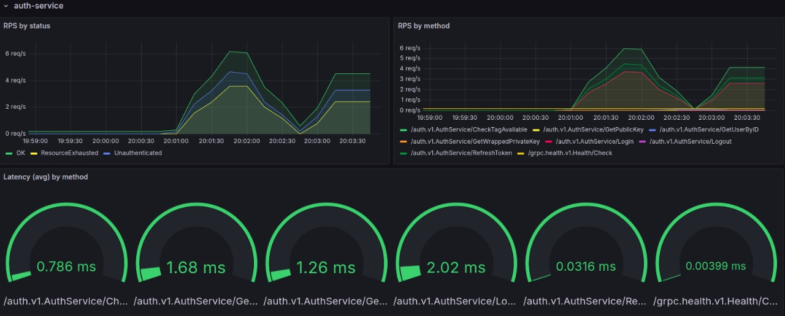
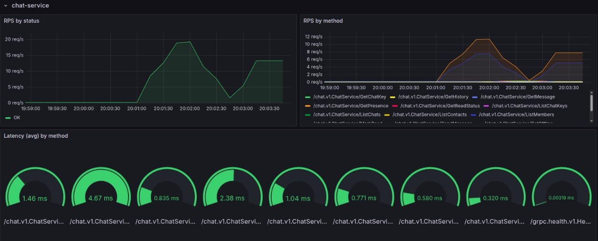
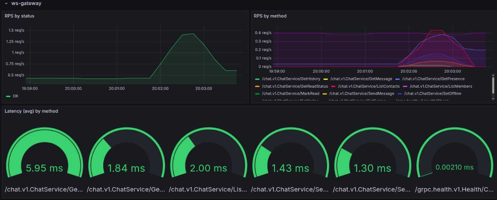
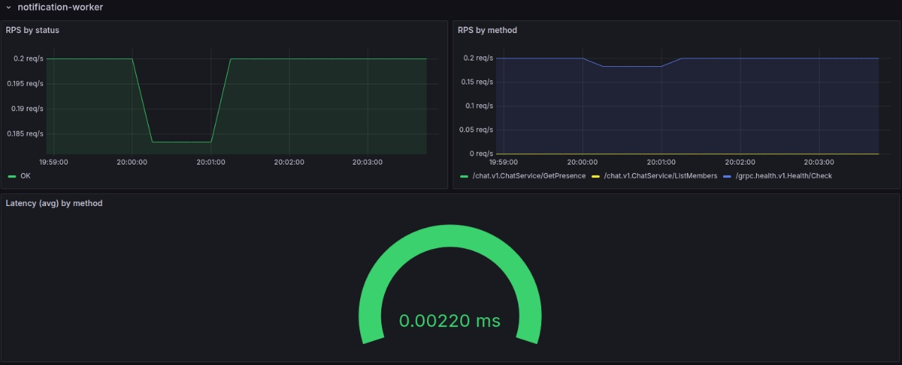
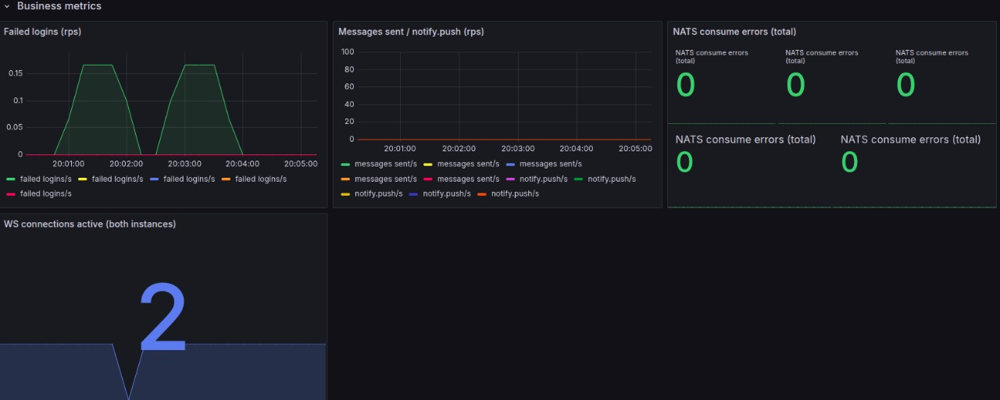
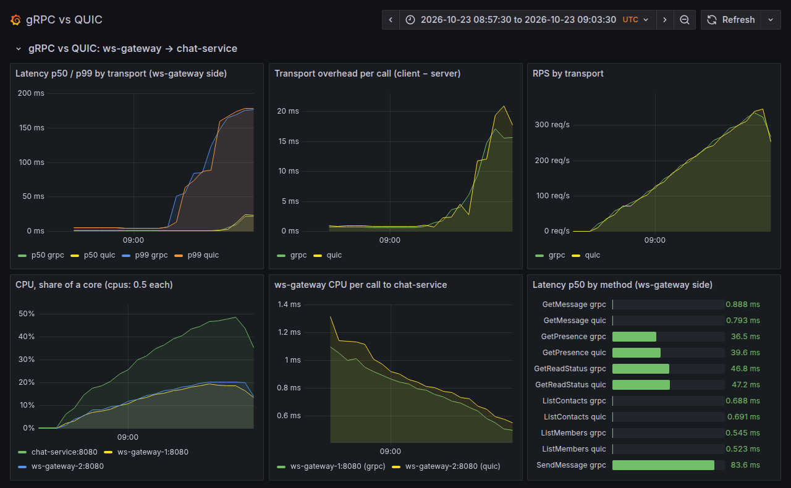
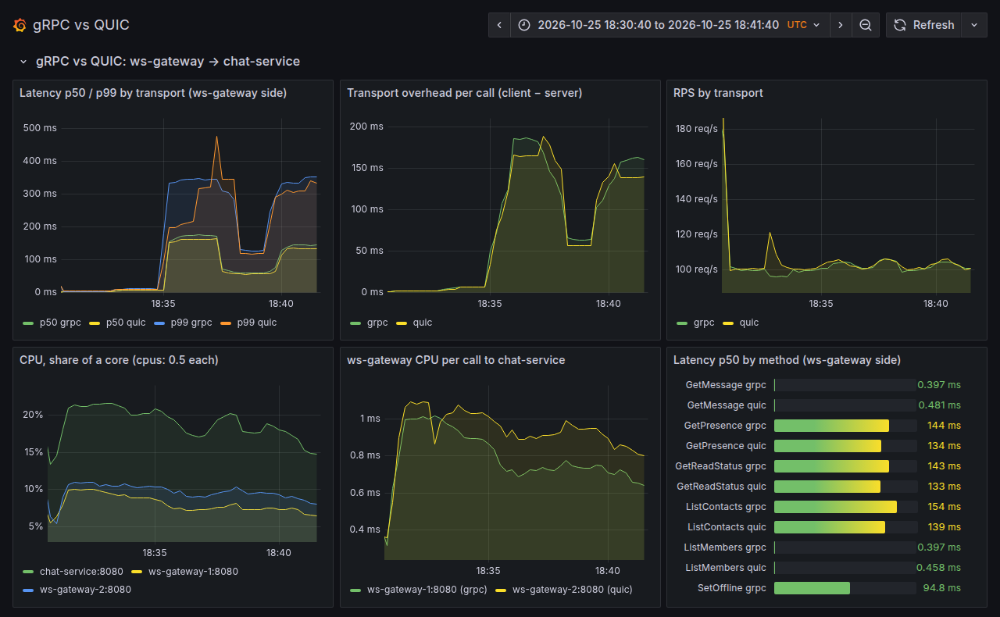

# Wisply

[](https://github.com/VladimirKhmelev/messenger-on-go/actions/workflows/ci.yml)
[](https://wisply.site)
[](https://vladimirkhmelev.github.io/messenger-on-go/swagger/)
[](https://go.dev)
[](LICENSE)

Real-time чат с E2E-шифрованием сообщений, реализованный как monorepo из 5
независимых микросервисов

> **Сейчас идёт эксперимент:** сервисы переводятся с gRPC на QUIC через
> [quic-rpc-go](https://github.com/VladimirKhmelev/quic-rpc-go) — RPC поверх
> нативных потоков QUIC, совместимый со сгенерированным gRPC-кодом. Цель —
> сравнить транспорты на живом мессенджере. Первый шаг готов: ws-gateway
> ходит в chat-service по QUIC при `CHAT_TRANSPORT=quic`, по умолчанию всё
> по-прежнему идёт по gRPC. Сравнение под нагрузкой: в хорошей сети QUIC
> медленнее на ~0.2 мс в медиане вызова, в сети с потерями — быстрее на 6–9% в
> медиане и на 11–14% в p99. Подробности — в разделе
> [«QUIC между сервисами»](#quic-между-сервисами-эксперимент).

## Архитектура

```
                          ┌──────────────┐
     браузер ── HTTPS ──▶ │    nginx     │
                          └──────┬───────┘
                                 │
      ┌────────────────┬─────────┴────────┬────────────────┐
      ▼                ▼                  ▼                ▼
┌─────────────┐  ┌─────────────┐  ┌──────────────┐  ┌─────────────┐
│auth-service │  │chat-service │  │media-service │  │ ws-gateway  │◀── WS
│  + Postgres │  │ + Postgres  │  │  + Postgres  │  │ (× 2 инст.) │
│  + Redis    │  │ + Redis     │  │  + MinIO     │  └──────┬──────┘
└──────┬──────┘  └──────┬──────┘  └──────┬───────┘         │
       │                │                │                 │
       └────────────────┴────────────────┴─────────────────┘
                         │ NATS JetStream / core pub-sub
                         ▼
              ┌────────────────────┐
              │ notification-worker│
              └────────────────────┘
```

| Сервис | Ответственность | Хранилище |
|---|---|---|
| `auth-service` | регистрация, логин, JWT, OAuth (GitHub), RSA-ключи для E2E | свой Postgres + Redis |
| `chat-service` | чаты, сообщения (зашифрованы на клиенте), presence, typing | свой Postgres + Redis |
| `media-service` | файлы в чатах — presigned upload/download URL | свой Postgres + MinIO |
| `ws-gateway` | держит WebSocket-соединения, офлайн-валидация JWT | без своей БД |
| `notification-worker` | слушает события, решает кому послать push-уведомление | без своей БД |

Сервисы не лезут в чужие таблицы напрямую — общаются через gRPC или события в
NATS.

## Ключевые особенности

- **End-to-end шифрование** — RSA-ключевая пара генерируется в браузере (Web
  Crypto API), приватный ключ хранится только на устройстве (обёрнутым
  паролем пользователя). Ключ каждого чата — отдельный AES-256-GCM ключ,
  зашифрованный RSA-публичным ключом каждого участника. Сервер физически не
  может прочитать содержимое сообщений — то же самое применимо и к
  медиафайлам (картинки/видео шифруются на клиенте тем же ключом чата,
  `media-service` работает как opaque blob store и не видит содержимое).
- **Файлы в чатах без прокси байтов через сервис** — клиент загружает/скачивает
  зашифрованный файл прямо в/из MinIO по presigned URL (S3-совместимое
  хранилище), `media-service` только выдаёт короткоживущий URL и проверяет
  membership в чате — Go-код не тратит CPU/трафик на передачу самих байтов.
- **Presence и typing-индикатор** — статус "в сети" привязан к реальной
  видимости вкладки/фокусу окна (`visibilitychange` + `blur`/`focus`), а не
  просто к открытому WS-соединению.
- **GitHub OAuth** — вход через GitHub с полноценной E2E-ключевой парой
  (не урезанный аккаунт без шифрования).
- **Realtime без потери сообщений** — переподключение с backoff, очередь
  исходящих сообщений на время разрыва, мёрж истории вместо перезаписи при
  гонке между `get_history` и live-сообщениями.

## Стек

```
              ┌─────────────────────────────────┐
   frontend   │  vanilla JS · Web Crypto API    │
              │  (RSA-OAEP + AES-256-GCM)       │
              ├─────────────────────────────────┤
   edge       │  nginx  +  Let's Encrypt        │
              ├─────────────────────────────────┤
   transport  │  gRPC + protobuf  ·  WebSocket  │
              ├─────────────────────────────────┤
   services   │  Go 1.26                        │
              ├─────────────────────────────────┤
   auth       │  JWT (golang-jwt)  +  bcrypt    │
              │  OAuth2 (GitHub)                │
              ├─────────────────────────────────┤
   messaging  │  NATS JetStream (nats.go)       │
              ├─────────────────────────────────┤
   storage    │  Postgres (pgx) · Redis · MinIO │
              ├─────────────────────────────────┤
   runtime    │  Docker Compose                 │
              └─────────────────────────────────┘
```

## Структура репозитория

```
docker-compose.yml              все 5 сервисов + Postgres×3 + Redis + NATS + MinIO + nginx
docker-compose.prod.yml         override для прода — образы из GHCR вместо build:
Makefile                        proto/up/down/unit/integration/lint/ci

services/
  auth-service/                 регистрация, логин, JWT, OAuth, RSA-ключи
    cmd/server/main.go            точка входа, wiring зависимостей
    internal/
      domain/                     доменные сущности + сентинел-ошибки
      repository/                 Postgres-репозиторий пользователей
      service/                    бизнес-логика (Register, Login, ChangePassword, ...)
      transport/
        grpc/                     gRPC-сервер + auth-интерцептор
        avatar/                   HTTP-хендлер загрузки/отдачи аватара (не protobuf JSON)
      oauth/                      GitHub OAuth-клиент
      mail/                       SMTP-отправка (verification code, password reset)
      cache/                      Redis: rate-limit, blacklist, email-коды, password reset
      jwtutil/                    выпуск и подпись JWT (внутренний, отдельно от pkg/jwtutil)
    Dockerfile                    multi-stage build, non-root user

  chat-service/                 чаты, сообщения, presence, typing
    cmd/server/main.go
    internal/
      domain/                     Chat, Message, ChatMember + ошибки
      repository/                 Postgres-репозиторий (чаты, сообщения, event log)
      service/                    бизнес-логика чатов, шифрование-агностично
      transport/grpc/             gRPC-сервер + auth/internal-интерцептор
      cache/                      Redis: presence (online/last-seen), typing, rate-limit
      events/                     публикация в NATS (msg.created, msg.updated, ...)
      authclient/                 gRPC-клиент к auth-service (UserExists)
    Dockerfile

  ws-gateway/                   держит WebSocket-соединения
    cmd/server/main.go
    internal/
      ws/                          handler (upgrade, origin-allowlist), session, registry, fanout
      chatclient/                  gRPC-клиент к chat-service
      events/                     NATS-консьюмер (JetStream + core pub/sub)
    Dockerfile

  notification-worker/          решает, кому и когда слать push
    cmd/worker/main.go
    internal/
      events/                     NATS-консьюмер входящих событий
      notify/                     логика "нужно ли уведомлять" + публикация notify.push
      chatclient/                  gRPC-клиент к chat-service
    Dockerfile

  media-service/                файлы в чатах (presigned upload/download через MinIO)
    cmd/server/main.go
    internal/
      domain/                     MediaObject + ошибки
      repository/                 Postgres-репозиторий метаданных загрузок + миграции
      minioclient/                 presigned PUT/GET URL, EnsureBucket, StatObject,
                                    rewrite внутреннего host на публичный
      service/                    бизнес-логика: лимит размера, membership-check,
                                    подтверждение реального попадания файла в MinIO
      transport/grpc/             gRPC-сервер + JWT auth-интерцептор
      chatclient/                  gRPC-клиент к chat-service (ListMembers)
    Dockerfile                    + grpc-health-probe для healthcheck

proto/
  auth/v1/auth.proto             контракт auth-service (+ HTTP-аннотации для grpc-gateway)
  chat/v1/chat.proto             контракт chat-service
  media/v1/media.proto           контракт media-service
  gen/                            сгенерированный код — отдельный Go-модуль, НЕ редактировать руками
    auth/v1/, chat/v1/, media/v1/  *.pb.go, *_grpc.pb.go, *.pb.gw.go
    openapi/                       messenger.swagger.json (публикуется на GitHub Pages)
  third_party/google/api/         google/api/annotations.proto (зависимость для HTTP-аннотаций)

pkg/
  jwtutil/                       офлайн-валидация JWT без похода в auth-service —
                                  используется chat-service и ws-gateway
  tracing/                       OpenTelemetry: TracerProvider (OTLP/gRPC → Jaeger),
                                  NATS producer/consumer спаны с trace context в headers
  metrics/                       Prometheus-метрики: gRPC interceptor'ы (RPS/latency
                                  по методу), /metrics-хендлер, бизнес-счётчики

frontend/                       ванильный JS без сборки, раздаётся nginx напрямую
  index.html
  js/
    main.js                       bootstrap, роутинг состояний, все обработчики событий
    api.js                        HTTP-клиент к auth/chat REST-эндпоинтам
    ws.js                          WebSocket-клиент, реконнект с backoff
    crypto.js                      RSA/AES E2E-шифрование через Web Crypto API
    state.js                       единый объект состояния приложения
    avatar.js, theme.js             вспомогательные модули
    screens/                      auth.js, sidebar.js, conversation.js, settings.js, toast.js
  styles/                        app.css, theme.css

nginx/
  nginx.conf                     dev-конфиг, самоподписанный сертификат, порты 8090/8443
  nginx.prod.conf                прод-конфиг, Let's Encrypt, стандартные порты 80/443
  certs/                         самоподписанные dev-сертификаты (не в репозитории)

metrics/
  promscrape.yml                 scrape-таргеты VictoriaMetrics (все 5 сервисов)
  grafana_*.png                  скриншоты дашборда для README (Monitoring)

grafana/
  dashboards/messenger.json      сам дашборд (gRPC RPS/latency по методам + бизнес-метрики)
  provisioning/                  datasource (VictoriaMetrics) + автозагрузка дашборда —
                                  поднимается сразу при старте, без ручной настройки

.github/workflows/
  ci.yml                        сборка + тесты каждого сервиса отдельно (матрица)
  pages.yml                     публикация Swagger UI + coverage на GitHub Pages
```

## Быстрый старт (локально)

Понадобится Docker и Docker Compose.

```bash
git clone https://github.com/VladimirKhmelev/messenger-on-go.git
cd messenger-on-go
make up          # docker-compose up -d --build
```

Открой **https://localhost:8443** (самоподписанный сертификат — браузер
попросит подтвердить исключение безопасности при первом заходе). Локально
письма верификации/сброса пароля перехватывает Mailhog — смотри их на
**http://localhost:8025**.

Остановить: `make down`.

## Другие команды

```bash
make proto         # регенерировать proto/gen из .proto файлов
make unit          # unit-тесты + coverage-репорт по всем сервисам
make integration   # integration-тесты (build tag `integration`)
make lint          # protolint + golangci-lint по всем сервисам
make ci            # полный набор проверок, как в GitHub Actions
```

## Деплой на прод

Продовая конфигурация отличается от локальной только набором переменных
окружения и nginx-конфигом — сам `docker-compose.yml` один и тот же.

1. **VPS** с Docker + Docker Compose, Ubuntu 24.04 LTS.
2. **DNS**: A-запись домена на IP сервера.
3. **TLS**: получить сертификат Let's Encrypt на хосте (`certbot certonly
   --standalone -d yourdomain.com`) — порт 80 должен быть свободен на момент
   получения.
4. **`.env`** в корне репозитория на сервере:
   ```
   JWT_SECRET=<случайная строка, openssl rand -hex 32>
   INTERNAL_SECRET=<случайная строка, openssl rand -hex 32>
   QUIC_RESET_SECRET=<случайная строка, openssl rand -hex 32>
   COOKIE_SECURE=true
   ALLOWED_ORIGINS=https://yourdomain.com

   GITHUB_CLIENT_ID=<из GitHub OAuth App>
   GITHUB_CLIENT_SECRET=<из GitHub OAuth App>

   SMTP_ADDR=smtp-relay.brevo.com:587
   SMTP_FROM=noreply@yourdomain.com
   SMTP_DISPLAY_NAME=YourAppName
   SMTP_USERNAME=<из SMTP-провайдера>
   SMTP_PASSWORD=<из SMTP-провайдера>

   MINIO_ROOT_USER=<случайная строка>
   MINIO_ROOT_PASSWORD=<случайная строка, openssl rand -hex 32>
   PUBLIC_MEDIA_URL=https://yourdomain.com/messenger-media

   # Своя VAPID-пара для прода — dev-ключи в docker-compose.yml не переиспользовать.
   # Сгенерировать: go run -exec "" -mod=mod - <<< '...' с webpush.GenerateVAPIDKeys(),
   # либо любым CLI-инструментом, генерирующим VAPID-ключи (P-256 ECDSA)
   VAPID_PUBLIC_KEY=<VAPID public key>
   VAPID_PRIVATE_KEY=<VAPID private key>
   VAPID_SUBJECT=mailto:admin@yourdomain.com

   NGINX_HTTP_PORT=80
   NGINX_HTTPS_PORT=443
   NGINX_CONF=./nginx/nginx.prod.conf
   LETSENCRYPT_DIR=/etc/letsencrypt
   ```
5. Во фронтенде (`frontend/index.html`) прописать `window.WISP_GITHUB_CLIENT_ID`
   на реальный GitHub OAuth `client_id` (он публичный)
6. `docker compose up -d --build`.

Автопродление Let's Encrypt настраивается certbot'ом автоматически
(systemd timer), никаких дополнительных действий не требуется.

## Monitoring & Observability

- **Трейсинг** — OpenTelemetry во всех 5 сервисах: gRPC (клиент+сервер через
  `otelgrpc.StatsHandler`) и NATS publish/consume (ручные producer/consumer
  спаны, trace context прокидывается через NATS message headers; media-service
  не публикует в NATS, но его gRPC-вызовы к chat-service трассируются так же).
  Экспорт в Jaeger (`jaegertracing/all-in-one`), UI — `http://localhost:16686`.
- **Метрики** — Prometheus-формат (`github.com/VictoriaMetrics/metrics`) на
  каждом сервисе: per-method gRPC RPS/latency (interceptor, аналогично
  трейсингу) + бизнес-метрики (failed logins, messages sent, notify.push,
  NATS consume errors, активные WS-соединения). VictoriaMetrics
  (single-node, встроенный `promscrape.config` — `metrics/promscrape.yml`)
  собирает `/metrics` со всех сервисов, Grafana поднимается с готовым
  дашбордом и датасорсом через provisioning — ничего не нужно настраивать
  руками, `http://localhost:3000` (admin/admin при первом входе).
- И Jaeger, и VictoriaMetrics, и Grafana привязаны к `127.0.0.1` в
  `docker-compose.yml` — ни один не имеет собственной аутентификации.

<p align="center">
  
  
</p>
<p align="center">
  
  
</p>
<p align="center">
  
</p>

## QUIC между сервисами (эксперимент)

Вызовы ws-gateway → chat-service могут идти не по gRPC, а по QUIC через
[quic-rpc-go](https://github.com/VladimirKhmelev/quic-rpc-go): тот же
сгенерированный gRPC-код поверх прослойки `grpcbridge`, с TLS 1.3. Это
эксперимент для сравнения транспортов; по умолчанию всё идёт по gRPC.

- chat-service слушает и gRPC (`50051/tcp`), и QUIC (`50051/udp`); код
  подключения — `pkg/quictransport`.
- ws-gateway выбирает транспорт переменной `CHAT_TRANSPORT`: `grpc` (по
  умолчанию) или `quic`:
  ```sh
  CHAT_TRANSPORT=quic docker-compose up -d ws-gateway-1 ws-gateway-2
  ```
  `WS_GATEWAY_1_CHAT_TRANSPORT` и `WS_GATEWAY_2_CHAT_TRANSPORT` задают
  транспорт одному гейтвею поверх `CHAT_TRANSPORT` — так оба транспорта
  работают одновременно на одном chat-service:
  ```sh
  WS_GATEWAY_1_CHAT_TRANSPORT=grpc WS_GATEWAY_2_CHAT_TRANSPORT=quic docker-compose up -d ws-gateway-1 ws-gateway-2
  ```
- Сертификаты выпускает одноразовый сервис `quic-certs`
  (`scripts/quic-certs.sh`) при первом `docker-compose up`: CA и сертификат
  chat-service; каждому сервису — свой volume, так что сервис видит только
  свой ключ. Перевыпустить — удалить volumes `quic-*`.
- В Jaeger QUIC-вызовы отмечены атрибутом `rpc.transport=quic`, а метрика
  `grpc_request_duration_seconds` — меткой `transport` (`grpc` или `quic`).
- Ключ stateless reset выводится из `QUIC_RESET_SECRET`: перезапущенный
  chat-service сразу сбрасывает старые соединения клиентов, а не через 30 с
  тишины.

### Сравнение с gRPC под нагрузкой

Генератор нагрузки `tools/wsload` подключает к каждому гейтвею по 200
выдуманных пользователей (токены подписывает dev-секретом `JWT_SECRET`,
каждому создаёт чат с самим собой) и шлёт смесь `get_presence` (45%),
`get_read_status` (45%) и `send_message` (10%) с пуассоновскими интервалами,
не дожидаясь ответов; скорость растёт ступенями. Он печатает задержку ответов
по ступеням, гейтвеям и запросам, считая от момента, когда запрос должен был
уйти. Строка «gRPC vs QUIC» дашборда Grafana показывает те же вызовы со
стороны сервисов.

```sh
WS_GATEWAY_1_CHAT_TRANSPORT=grpc WS_GATEWAY_2_CHAT_TRANSPORT=quic docker-compose up -d
cd tools/wsload
go run . -gateways grpc=ws://localhost:8080/ws,quic=ws://localhost:8081/ws -steps 100,200,300,400,500
```

Результаты на локальном стенде (23.10.2026, ноутбук, у сервисов `cpus: 0.5`):
два прогона по минуте на ступень, во втором гейтвеи обменялись транспортами;
в таблице среднее двух прогонов; до 400 rps их медианы расходятся не больше
чем на 0.05 мс. Задержки — вызовы ws-gateway → chat-service по метрике
`grpc_request_duration_seconds`, gRPC / QUIC. Накладные расходы — среднее
время вызова на клиенте минус среднее время обработки на сервере: транспорт,
сериализация и очереди.

| Нагрузка, rps | p50, мс | p99, мс | Накладные расходы, мс | CPU гейтвея на вызов, мс | CPU chat-service |
|---|---|---|---|---|---|
| 100 | 1.12 / 1.33 | 5.61 / 5.76 | 0.70 / 0.89 | 1.02 / 1.14 (+12%) | 18% |
| 200 | 0.96 / 1.13 | 4.45 / 4.56 | 0.60 / 0.77 | 0.83 / 0.88 (+5%) | 27% |
| 300 | 0.91 / 1.08 | 12.4 / 9.5 | 0.88 / 0.96 | 0.75 / 0.79 (+5%) | 37% |
| 400 | 0.97 / 1.13 | 96.6 / 93.0 | 4.76 / 4.78 | 0.69 / 0.73 (+6%) | 46% |
| 500 | 22.4 / 23.1 | 177 / 179 | 20.7 / 20.9 | 0.51 / 0.57 (+12%) | 49% |

- Пока chat-service не загружен, QUIC медленнее gRPC на 0.16–0.21 мс в
  медиане вызова и тратит на 5–12% больше CPU гейтвея на вызов. Хвосты (p99)
  у транспортов одинаковы в пределах шума. В задержке ответа по WebSocket
  (2–3 мс у `wsload`) разница та же — около 0.2 мс.
- С 400 rps упирается chat-service: он подходит к своим 0.5 ядра, и запросы
  ждут его CPU ещё до обработчика — отсюда рост накладных расходов и хвостов
  у обоих транспортов одинаково. Транспорт здесь не узкое место.
- Сравнение неравное в пользу gRPC: между сервисами он идёт без TLS, а QUIC
  всегда шифрует (TLS 1.3), и часть разницы — цена шифрования.
- Сеть здесь — мост докера на одной машине, без потерь и с задержкой в доли
  миллисекунды: в таких условиях у QUIC нет преимуществ. Потери пакетов,
  переподключения и задержки сети этот замер не проверяет.

<p align="center">
  
</p>

### Плохая сеть (netem)

`scripts/netem.sh` портит участок ws-gateway ↔ chat-service профилями стенда
quic-rpc-go (`testbed/scenarios/profiles.yaml`), пока без ограничения полосы и
обрывов связи: задержка делится между направлениями поровну, джиттер и потери
действуют на каждое. netem стоит на `eth0` гейтвеев и chat-service и задевает
только пакеты к собеседнику — Postgres, Redis, NATS и клиенты WebSocket
работают как обычно. Как на стенде, склейка пакетов выключена (TSO и GSO на
`eth0`, GSO в quic-go через `QUIC_GO_DISABLE_GSO=true`): иначе netem терял бы
пачку пакетов целиком, как один. `sudo` не нужен — скрипт запускает `tc` и
`ethtool` в маленьком контейнере (`scripts/netem.Dockerfile`) в сетевом
пространстве сервиса.

```sh
WS_GATEWAY_1_CHAT_TRANSPORT=grpc WS_GATEWAY_2_CHAT_TRANSPORT=quic QUIC_GO_DISABLE_GSO=true docker-compose up -d
for p in datacenter nearby-zones interregion congested degraded; do
  scripts/netem.sh "$p"
  (cd tools/wsload && go run . -gateways grpc=ws://localhost:8080/ws,quic=ws://localhost:8081/ws \
    -steps 200 -step 2m -mix get_presence=50,get_read_status=50)
done
scripts/netem.sh off
```

Результаты (25.10.2026): 200 rps, по 2 минуты на профиль, две серии, во второй
гейтвеи обменялись транспортами; в таблице среднее двух серий. Задержки —
вызовы ws-gateway → chat-service по метрике `grpc_request_duration_seconds`,
gRPC / QUIC.

| Профиль | RTT | Джиттер | Потери | p50, мс | p99, мс | CPU гейтвея на вызов, мс |
|---|---|---|---|---|---|---|
| datacenter | 1 мс | — | — | 2.25 / 2.44 | 3.43 / 3.63 | 1.00 / 1.08 (+8%) |
| nearby-zones | 5 мс | 1 мс | 0.1% | 6.74 / 6.73 | 10.8 / 10.5 | 0.92 / 1.06 (+16%) |
| interregion | 150 мс | 10 мс | 0.5% | 173 / 162 | 348 / 300 | 0.73 / 0.91 (+26%) |
| congested | 50 мс | 5 мс | 1% | 59.8 / 55.9 | 134 / 120 | 0.77 / 0.98 (+28%) |
| degraded | 100 мс | 20 мс | 2% пачками, 1% перестановок | 147 / 134 | 355 / 315 ¹ | 0.68 / 0.83 (+22%) ¹ |

¹ Первая серия: во второй соединение gRPC встало, см. ниже.

- Без потерь QUIC по-прежнему медленнее на ~0.2 мс; при задержке в 5 мс и
  редких потерях транспорты сравниваются.
- С потерями QUIC быстрее: на 4–14 мс (6–9%) в медиане и на 15–48 мс (11–14%)
  в p99. Причина — блокировка очереди в TCP: все вызовы gRPC к chat-service
  идут по одному соединению, и потерянный пакет задерживает все вызовы за ним,
  пока не дойдёт повтор; в QUIC у каждого вызова свой поток, и ждёт только
  вызов с потерей.
- Во второй серии на degraded соединение gRPC простояло ~25 с: повторные
  передачи терялись раз за разом, и TCP удваивал паузу между ними. 800 вызовов
  упали по таймауту (10 с), ещё 2710 запросов остались без ответа; QUIC в это
  время отвечал как обычно. Отчасти это свойство модели потерь netem: пачка
  отсчитывается в пакетах, а пока TCP ждёт, он шлёт один пакет за паузу, и
  плохое состояние канала растягивается на секунды.
- QUIC платит процессором: на плохой сети на 16–28% больше CPU гейтвея на
  вызов — восстановление потерь, подтверждения и шифрование идут в userspace.
- В нагрузке нет `send_message`: ws-gateway разбирает события рассылки по
  одному, с двумя вызовами chat-service на каждое, и на медленной сети не
  успевает за ними — это отдельная проблема гейтвея, и её фон портил бы
  сравнение.
- Ограничения те же, что выше: одна машина, gRPC без TLS. Кроме того, netem с
  джиттером не переставляет пакеты, поэтому при плотном трафике они ждут друг
  друга, и задержка выше номинальной: медиана interregion — 162–173 мс при
  RTT 150 мс.

<p align="center">
  
</p>

## Тестовая инфраструктура

- Unit-тесты — рядом с кодом в каждом пакете.
- Integration-тесты — в тех же пакетах под build tag `integration`
  (testcontainers, реальный Postgres/Redis).
- CI (GitHub Actions) — сборка и тесты каждого сервиса отдельно,
  результаты и Swagger UI публикуются на GitHub Pages при мёрже в `main`.
